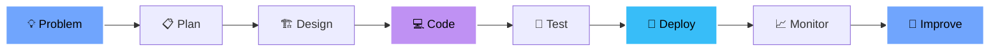

<div align="center">

# Hi, I'm Amit Kumar 👋

### Full-Stack Developer | AI Integration | Top 7 @ INDIA INNOVATES'26 | Amazon ML Challenge 2025 – Rank 228


[](https://www.linkedin.com/in/amitkumar0027/)
[](mailto:amitkumar911344@gmail.com)
[](https://github.com/amitakr0027)

</div>

---

## ⚡ Recruiter Quick View

<div align="center">

| 🎓 **Education** | 📅 **Graduating** | 🎯 **Looking for** | 🏆 **Best proof of work** |
|:---:|:---:|:---:|:---:|
| B.Tech CSE, LNCTS Bhopal<br/>**CGPA 8.16 / 10** | **2027** | Full-stack / SDE roles and internships | **BharatSeva** (live) · **FoodSnap** (live) · Top 7 of 26,000+ · AIR 228 of 82,798 · **Merged PR in Jenkins** |

[🌐 BharatSeva Live](https://bharat-service-pi.vercel.app/) • [🍎 FoodSnap Live](https://foodsnap-plum.vercel.app) • [💻 All Repositories](https://github.com/amitakr0027?tab=repositories) • [✉️ amitkumar911344@gmail.com](mailto:amitkumar911344@gmail.com)

</div>

---

## 👨‍💻 About Me


```typescript
const amitKumar = {
    location: "India 🇮🇳",
    education: "B.Tech CSE, LNCTS Bhopal (Batch of 2027) | CGPA 8.16/10",
    role: "Full-Stack Developer",
    
    focus: [
        "Production-Ready Applications",
        "AI/ML Integration",
        "System Architecture",
        "Data Structures & Algorithms"
    ],
    
    achievements: [
        "Top 7 of 26,000+ entries - INDIA INNOVATES'26 (BharatSeva)",
        "All India Rank 228 / 82,798 - Amazon ML Challenge 2025 (Top 0.3%)",
        "Cisco AICTE Virtual Internship in Artificial Intelligence (2026)",
        "Open source: merged PR (#1809) in Jenkins git-client-plugin; another (#1808) under review",
        "Mentored 50+ students in Generative AI",
        "Smart India Hackathon 2025 - cleared the internal selection round"
    ],
    
    approach: "Clean code, scalable systems, user-first design",
    
    currentlyBuilding: "AI-powered web applications",
    learningNext: "Advanced system design patterns",
    openTo: "Full-time SDE roles, internships & collaborations"
};
```

I'm a final-year Computer Science student who builds **full-stack applications with AI at the core** — from civic-tech platforms to health-tech and nutrition tools. I care about systems that are not just functional, but **performant, secure, and maintainable**, and I back that up with competitive results in hackathons and ML competitions.

---

## 🏆 Highlights

<div align="center">

| 🥇 **INDIA INNOVATES'26** | 🤖 **Amazon ML Challenge 2025** | 🎓 **Mentorship** | 🇮🇳 **Smart India Hackathon** |
|:---:|:---:|:---:|:---:|
| **Top 7** out of 26,000+ entries | **All India Rank 228** of 82,798 (Top 0.3%) | **50+ students** mentored in Generative AI | **SIH 2025** – cleared the internal selection round |
| Presented **BharatSeva** at the Bharat Mandapam finale, New Delhi, to the judges, in the presence of Delhi Chief Minister Rekha Gupta and Unstop CEO Ankit Aggarwal | Predicted product prices from 75,000+ images (Team 0xer, team of 4) | Hands-on Generative AI guidance | Team-based problem solving |

</div>

---

## 🧑‍💼 Experience & Programs

<div align="center">

| Role / Program | Organisation | Period | What I did |
|:---|:---:|:---:|:---|
| **Full-Stack Developer** (hackathon project) | BharatSeva · INDIA INNOVATES'26 (Unstop) | Feb – Apr 2026 | Worked with a team on architecture, frontend, backend and deployment; designed complaint routing and SLA escalation workflows; integrated the Twilio WhatsApp API; **Top 7 of 26,000+** |
| **Virtual Internship in Artificial Intelligence** | Cisco Networking Academy & AICTE | Jun – Aug 2026 | Completed Cisco's AI pathway: *Introduction to Modern AI* and *Apply AI: Analyzing Customer Reviews* · [Certificate](https://drive.google.com/file/d/1Kxj48itUziSdwTpspQ7eT_lLtMyHbxsl/view?usp=drivesdk) |
| **Innovation, Design and Entrepreneurship (IDE) Bootcamp** | IIT Roorkee (TIDES, AICTE) | Apr 2026 | Participated in Edition 3, Phase 2 |

</div>

---

## 🌍 Open Source Contributions

<div align="center">

**Contributing to [Jenkins](https://www.jenkins.io/), the open-source automation server — [Git client plugin](https://github.com/jenkinsci/git-client-plugin) (Java)**

| Pull request | Status | What I did |
|:---|:---:|:---|
| [**#1809** · Update MinGit installation instructions for MinGit 2.56.0 and later](https://github.com/jenkinsci/git-client-plugin/pull/1809)<br/>Fixes [#1807](https://github.com/jenkinsci/git-client-plugin/issues/1807) | ✅ **Merged** | Documentation fix the maintainer asked contributors for. Checked the contents of the new MinGit release zip, tested two install configurations on a local Jenkins 2.516.3, replaced the configuration screenshot, and addressed review feedback (use a placeholder download URL instead of GitHub.com). |
| [**#1808** · Show hex exit code of failed git commands on Windows](https://github.com/jenkinsci/git-client-plugin/pull/1808)<br/>Fixes [#1612](https://github.com/jenkinsci/git-client-plugin/issues/1612) | 🔄 **Open, under review** | Windows reports crashes as signed numbers like `-1073741502` instead of the searchable `0xC0000142`. Added a small, unit-tested helper that appends the hex value and a link to Microsoft's error-code documentation, leaving the existing message text unchanged. CI passes on Linux and Windows. |

**Skills used:** Java, Maven, JUnit 5, static analysis (SpotBugs, CheckStyle), git, CI on Linux and Windows, code review, documentation

</div>

---

## 🛠️ Technology Stack

<div align="center">

### Languages


### Frontend


### Backend & Database


### AI, APIs & Cloud


### Tools & Workflow


</div>

---

## 🌟 Featured Project: BharatSeva

<div align="center">

### 🏛️ AI-Assisted Civic Grievance Management Platform

**Top 7 out of 26,000+ entries at INDIA INNOVATES'26 — presented at the national finale in New Delhi**

[](https://bharat-service-pi.vercel.app/)
[](https://github.com/adityatiwarig/Bharat-service.git)


**500+ complaints handled · 4 role-based dashboards · ~60% less manual triage effort · ~35% faster average resolution**

</div>

<br/>

<table>
<tr>
<td width="50%">

### ✨ Core Features

**Grievance Management**
- AI-assisted handling of civic complaints
- End-to-end tracking for citizens, L1/L2/L3 officers and admins (4 role-based dashboards)
- Rule-based intelligence engine: keyword scoring, sentiment analysis, danger detection, spam filtering and hotspot detection
- SLA escalation engine with deadline tracking

**Communication**
- Twilio WhatsApp integration: file and track complaints without installing an app
- Gemini-powered Hinglish/English citizen chatbot
- Accessible to citizens where they already are

**Insights & Reporting**
- Ward-wise heatmap analytics
- Geo-tagged evidence uploads
- PDF export of reports

**Security**
- JWT-based authentication and role-based access
- Secure server-side architecture

</td>
<td width="50%">

### 🏗️ Technical Architecture

**Frontend**
```javascript
// Next.js + TypeScript
- Server/Client components
- Type-safe codebase
- Role-based dashboards
- Deployed on Vercel
```

**Backend Design**
```javascript
// Scalable & Secure
- PostgreSQL + Prisma ORM
- Redis for caching/performance
- JWT authentication
- Twilio WhatsApp API
- SLA & escalation workflows
```

**AI Integration**
```javascript
// AI-assisted workflows
- Gemini API chatbot (Hinglish/English)
- Intelligent grievance processing
- Prompt engineering
```

</td>
</tr>
</table>

---

## 🍎 Featured Project: FoodSnap

<div align="center">

### AI-Powered Food Analysis Platform

**Scan Smart, Eat Healthy — Your AI Food Intelligence System**

[](https://foodsnap-plum.vercel.app)
[](https://github.com/amitakr0027/FOODSNAP)


**3M+ food items · A–E health grades · allergen alerts · 6 dietary categories**

</div>

<br/>

<table>
<tr>
<td width="50%">

### ✨ Core Features

**Smart Scanning**
- Real-time barcode recognition
- Camera integration with instant detection
- OpenFoodFacts API product database integration (3M+ items)

**AI Analysis**
- Powered by Google Gemini 3 Flash
- Comprehensive nutrition breakdown
- Ingredient safety scoring and A–E health grades
- Allergen detection and dietary classification across 6 categories

**Personalization**
- Custom allergen detection
- User health profile tracking
- Dietary preference alerts
- Scan history & favorites (persistent across sessions)

**Security & Performance**
- Server-side API architecture
- No exposed credentials
- Optimized rendering

</td>
<td width="50%">

### 🏗️ Technical Architecture

**Frontend Excellence**
```javascript
// Next.js 14 App Router
- TypeScript strict mode
- Server/Client components
- Optimized image loading
- Virtual list rendering
- Debounced search
```

**Backend Design**
```javascript
// Secure & Scalable
- Node.js runtime (Vercel)
- RESTful API design
- Input validation
- Firebase Authentication
- Firestore database
```

**AI Integration**
```javascript
// Intelligent Processing
- Google Gemini 3 Flash
- Server-only inference
- Prompt engineering
- Response parsing
```

</td>
</tr>
</table>

<div align="center">

[🚀 Try Live Demo](https://foodsnap-plum.vercel.app) • [📖 Read Documentation](https://github.com/amitakr0027/FOODSNAP#readme)

</div>

---

## 🧩 More Projects

<div align="center">

| Project | What it does | Tech |
|:---:|:---|:---|
| **🏥 AyuSync** | Health-tech app built on standard healthcare interoperability APIs | FHIR R4 APIs, Firebase Auth, Firestore |
| **🎓 ViduCate** | Full-stack web application | Next.js, TypeScript, Node.js, PostgreSQL, Prisma |

[💻 Explore all repositories](https://github.com/amitakr0027?tab=repositories)

</div>

---

## 📜 Certifications

<div align="center">

| Certification | Issuer | Date | Credential |
|:---|:---:|:---:|:---:|
| Java Full Stack (Digital Skills Readiness Program) | Wipro TalentNext | Jul – Oct 2026 | [View](https://drive.google.com/file/d/1h6IzessTOUYVqjTl15Rl0iFBKMHEv08p/view?usp=drivesdk) |
| Cisco AICTE Virtual Internship in Artificial Intelligence | Cisco Networking Academy & AICTE | Jun – Aug 2026 | [View](https://drive.google.com/file/d/1Kxj48itUziSdwTpspQ7eT_lLtMyHbxsl/view?usp=drivesdk) |
| Prompt Engineering and ChatGPT | NASSCOM FutureSkills Prime | Sep 2026 | [View](https://drive.google.com/file/d/1n-nNNf-im2E3AWcefCrzXACb4oXZ7bbi/view?usp=drive_link) |
| Data Structures & Algorithms using Java | Infosys Springboard | Mar 2026 | [View](https://drive.google.com/file/d/1VJPg_VNMTGYrODzGJYKKLmSDZXietHAA/view?usp=sharing) |
| Agile Project Management | Udemy | May 2026 | [View](https://ude.my/UC-14a29770-e13c-47c9-815b-469dd7fada63) |
| Learn Azure DevOps CI/CD Pipelines | Udemy | May 2026 | [View](https://ude.my/UC-edc37e30-63a0-4b42-8df6-49584d8423b6) |
| Oracle Cloud Infrastructure 2025 Certified AI Foundations Associate | Oracle University | Sep 2025 | [View](https://drive.google.com/file/d/11T5hflmp5sdM1VqlBbKaiCH_YIeT_cSt/view?usp=sharing) |

</div>

---

## 📊 GitHub Statistics

<div align="center">


</div>

---

## 💡 Development Philosophy

<div align="center">



</div>

### Core Principles

<table>
<tr>
<td align="center" width="25%">
<br/>
<b>Clean Code</b><br/>
<sub>Readable, maintainable,<br/>self-documenting</sub>
</td>
<td align="center" width="25%">
<br/>
<b>Performance</b><br/>
<sub>Optimized from<br/>the ground up</sub>
</td>
<td align="center" width="25%">
<br/>
<b>Security</b><br/>
<sub>Authentication,<br/>validation, best practices</sub>
</td>
<td align="center" width="25%">
<br/>
<b>Scalability</b><br/>
<sub>Built for growth<br/>and real-world use</sub>
</td>
</tr>
</table>

---

## 🎯 What I Bring

<table>
<tr>
<td width="50%">

### 💼 Technical Skills

- ✅ Full-stack development (Next.js, React, TypeScript, Node.js)
- ✅ Java, SQL & strong DSA fundamentals (300+ problems solved)
- ✅ AI/ML integration (Google Gemini, OpenAI) and an image-based ML competition result (AIR 228)
- ✅ Database design (PostgreSQL + Prisma, Redis, Firestore, MongoDB)
- ✅ RESTful API development & JWT authentication with role-based access
- ✅ Workflow automation: rule-based prioritization, SLA tracking and escalation
- ✅ Third-party integrations (Twilio WhatsApp, OpenFoodFacts, FHIR R4)
- ✅ Cloud deployment (Vercel, Firebase, GCP)
- ✅ CI/CD & Agile fundamentals (Azure DevOps, Agile certified)
- ✅ Open-source contributions in Java (Jenkins git-client-plugin): merged documentation fix, plus a unit-tested pull request under review (JUnit 5, SpotBugs, CheckStyle)
- ✅ Security best practices

</td>
<td width="50%">

### 🚀 Professional Approach

- ✅ Self-driven and proactive
- ✅ Proven under pressure — national-level finalist at INDIA INNOVATES'26
- ✅ Competitive problem solver — Top 0.3% at Amazon ML Challenge 2025
- ✅ Mentor — guided 50+ students in Generative AI
- ✅ Clear technical communication & presentation skills — presented BharatSeva at the national finale
- ✅ Collaborative team player
- ✅ Open to feedback and mentorship — addressed a maintainer's review feedback to get an open-source PR merged
- ✅ Continuous learning mindset
- ✅ Documentation and code quality focus

</td>
</tr>
</table>

---

## 🏅 GitHub Achievements

<div align="center">

[](https://github.com/ryo-ma/github-profile-trophy)

</div>

---

## 🔭 Current Focus

<div align="center">

| 💼 Working On | 🌱 Learning | 👯 Open To | 💡 Exploring |
|:---:|:---:|:---:|:---:|
| Scaling AI Applications | Advanced System Design | Full-Time SDE Roles | Cloud Architecture |
| Performance Optimization | Graphs & Dynamic Programming | Internships | DevOps Practices |
| Open Source: Jenkins git-client-plugin | Next.js 15 Features | Freelance & Remote Projects | Generative AI |

</div>

---

## 📫 Let's Connect

<div align="center">


### I'm always open to discussing:

💼 **Full-Time Opportunities** • 🚀 **Freelance Projects** • 🤝 **Collaborations** • 💡 **Tech Discussions**

<br/>

[](https://www.linkedin.com/in/amitkumar0027/)
[](mailto:amitkumar911344@gmail.com)
[](https://github.com/amitakr0027)

<br/>

### 📱 Check Out My Work

[](https://bharat-service-pi.vercel.app/)
[](https://foodsnap-plum.vercel.app)
[](https://github.com/amitakr0027?tab=repositories)

---


### ⚡ *Building production-ready systems, one commit at a time*

**💼 Open to Full-Time Software Engineering Roles & Internships | Remote | Hybrid | On-site**

<sub>Crafted with 💙 by Amit Kumar • Last Updated: November 2026</sub>

</div>

---

<div align="center">

**💭 "Code is like humor. When you have to explain it, it's bad." — Cory House**

⭐ **Star my repositories if you find them useful!**

</div>
